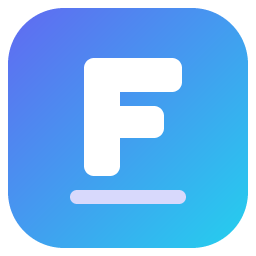
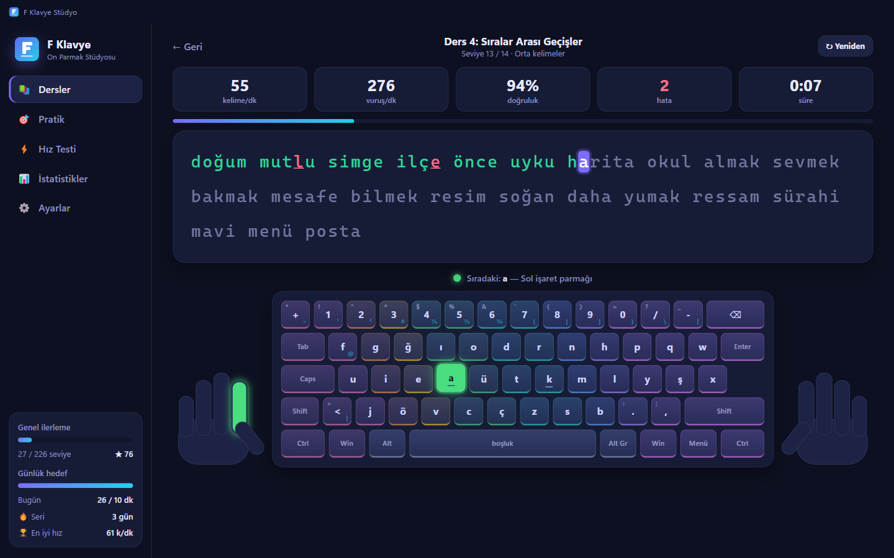
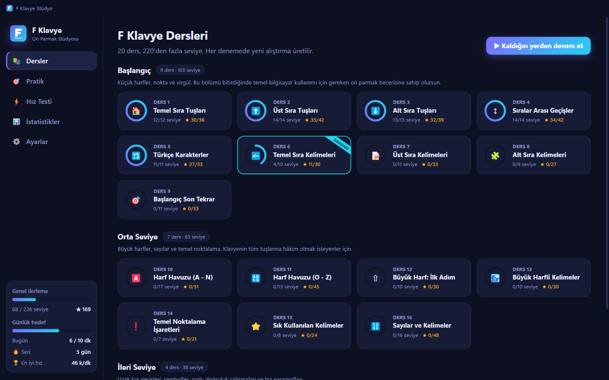
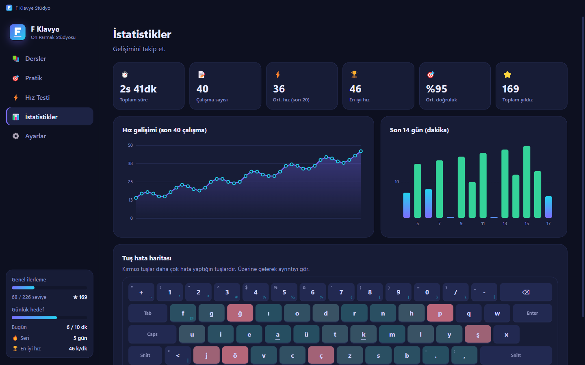
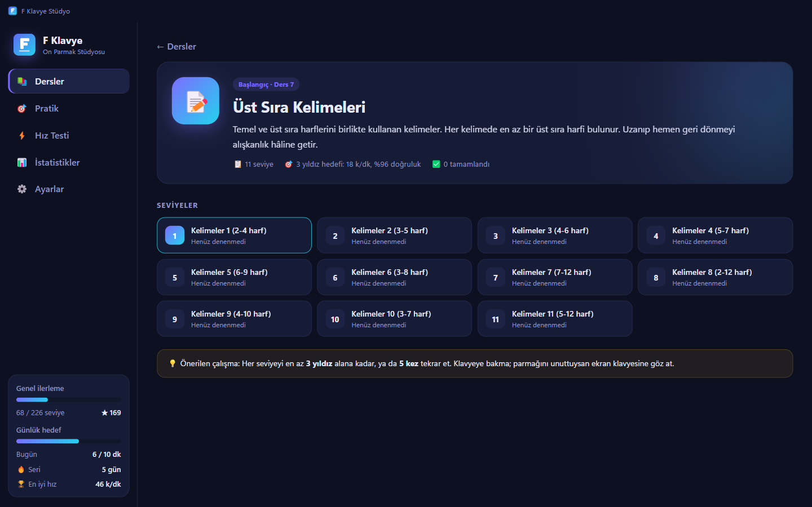
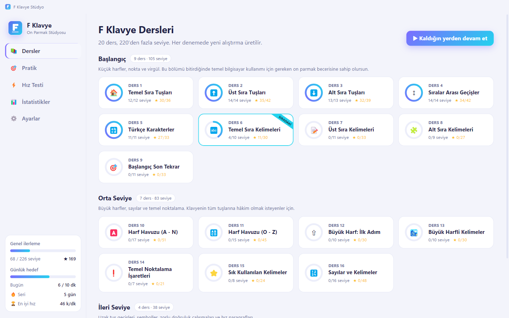
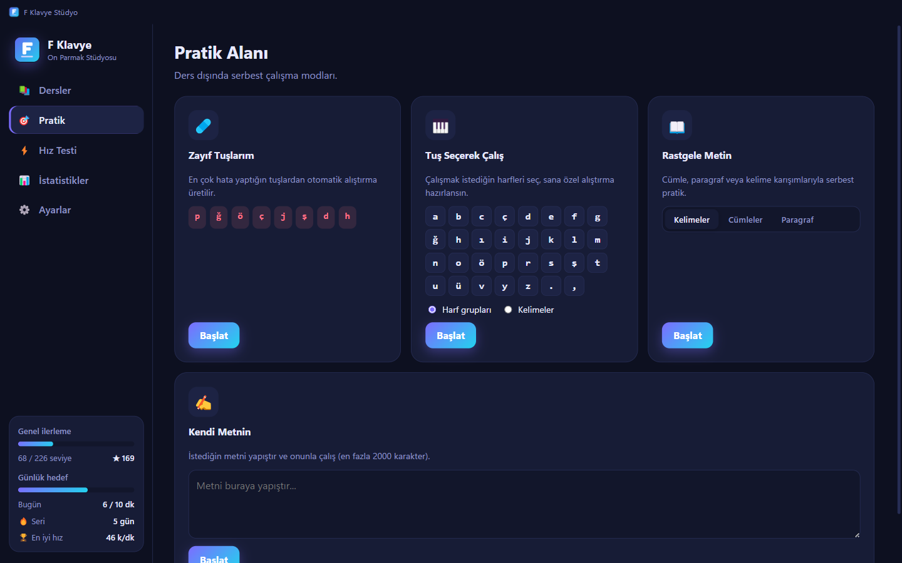
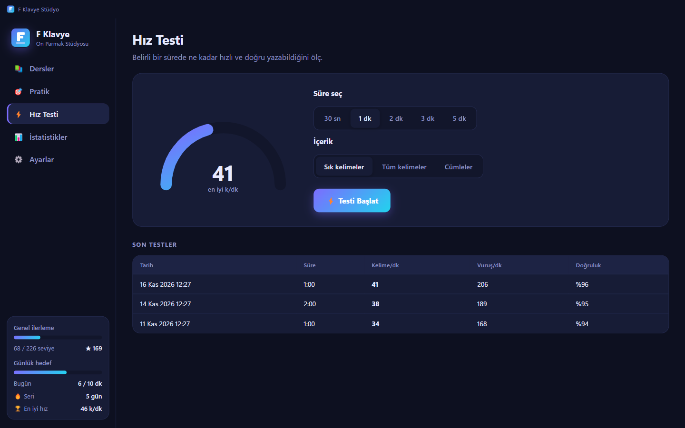

<div align="center">



# F Klavye Stüdyo

**Türkçe F klavye için modern on parmak eğitim uygulaması**

Temel sıradan hız paragraflarına kadar 20 ders ve 226 seviye. Her denemede yeni alıştırma üretilir.

<br>


<br>

<a href="../../releases/latest"></a>

<br><br>

[**🚀 Hızlı Başlangıç**](#-hızlı-başlangıç) &nbsp;·&nbsp;
[**✨ Özellikler**](#-özellikler) &nbsp;·&nbsp;
[**📚 Ders Programı**](#-ders-programı) &nbsp;·&nbsp;
[**⌨️ Parmak Haritası**](#️-parmak-haritası) &nbsp;·&nbsp;
[**🛠️ Kaynaktan Derleme**](#️-kaynaktan-derleme)

<br>



</div>

<br>

## 🚀 Hızlı Başlangıç

> [!TIP]
> Kurulum yok, internet gerekmez. Tek dosyayı çalıştırman yeterli.

1. **[Releases](../../releases/latest)** sayfasından **`F Klavye Stüdyo.exe`** dosyasını indir ve çift tıkla.
2. **Dersler** sayfasında **▶ Kaldığın yerden devam et** düğmesine bas.
3. Mavi işaretli harfe, ekranda gösterilen parmakla bas. Klavyeye değil, ekrana bak.

> [!NOTE]
> Uygulama dijital olarak imzalı değildir. İlk açılışta Windows SmartScreen uyarı verirse **Ek bilgi → Yine de çalıştır** seçeneğine tıkla.

<br>

## ✨ Özellikler

<table>
<tr>
<td width="50%" valign="top">

### 🎹 F Emülasyonu
Bilgisayarında **Q klavye kurulu olsa bile** tuşlar fiziksel konumlarına göre F klavye olarak yorumlanır. Windows dil ayarlarını değiştirmen gerekmez.

</td>
<td width="50%" valign="top">

### 🖐️ Parmak Rehberi
Renkli parmak bölgeli ekran klavyesi ve el şeması, sıradaki tuşu ve kullanman gereken parmağı gösterir. Gereken **Shift** veya **Alt Gr** tuşu da işaretlenir.

</td>
</tr>
<tr>
<td valign="top">

### ♾️ Sonsuz Alıştırma
925 kelimelik Türkçe havuzdan her denemede **yeni metin** üretilir. Aynı seviyeyi tekrar açtığında ezber değil, gerçek beceri çalışırsın.

</td>
<td valign="top">

### 📈 Anlık Ölçüm
Kelime/dk, vuruş/dk, doğruluk ve hata sayısı yazarken canlı güncellenir. **3 saniyeden uzun duraklamalar süreye eklenmez.**

</td>
</tr>
<tr>
<td valign="top">

### ⭐ Yıldız Sistemi
Her seviye 3 yıldız üzerinden puanlanır. İlerleme otomatik kaydedilir, uygulama seni bir sonraki seviyeye yönlendirir.

</td>
<td valign="top">

### 🩹 Zayıf Tuş Analizi
En çok hata yaptığın tuşlar tespit edilir ve yalnızca bu tuşlardan oluşan **kişisel alıştırmalar** hazırlanır.

</td>
</tr>
<tr>
<td valign="top">

### ⚡ Hız Testi
30 saniyeden 5 dakikaya kadar süre seçebilirsin. Sık kelimeler, tüm kelimeler veya cümlelerle test olursun. Son sonuçlar listelenir.

</td>
<td valign="top">

### 🎨 Modern Arayüz
Koyu ve açık tema, üç yazı boyutu, isteğe bağlı ses efektleri, konfeti kutlamaları ve tam ekran modu.

</td>
</tr>
</table>

<br>

<div align="center">

| 📚 Dersler | 📊 İstatistikler |
|:---:|:---:|
|  |  |
| **📖 Ders Detayı** | **☀️ Açık Tema** |
|  |  |
| **🎯 Pratik Alanı** | **⚡ Hız Testi** |
|  |  |

</div>

<br>

## 📚 Ders Programı

<details open>
<summary><b>🟢 Başlangıç</b>: küçük harfler, nokta ve virgül &nbsp;<code>9 ders · 105 seviye</code></summary>
<br>

| # | Ders | Seviye | İçerik |
|:-:|------|:------:|--------|
| 1 | 🏠 Temel Sıra Tuşları | 12 | `u i e a ü` · `t k m l y ş x` |
| 2 | ⬆️ Üst Sıra Tuşları | 14 | `f g ğ ı o` · `d r n h p q w` |
| 3 | ⬇️ Alt Sıra Tuşları | 13 | `j ö v c ç` · `z s b . ,` |
| 4 | ↕️ Sıralar Arası Geçişler | 14 | Her parmağın kendi sütunu |
| 5 | 🔡 Türkçe Karakterler | 11 | `ğ ü ş ı ö ç` |
| 6 | 🔤 Temel Sıra Kelimeleri | 10 | Yalnızca temel sıra kelimeleri |
| 7 | 📝 Üst Sıra Kelimeleri | 11 | Temel ve üst sıra karışık |
| 8 | 🧩 Alt Sıra Kelimeleri | 9 | Üç sıranın tamamı |
| 9 | 🎯 Başlangıç Son Tekrar | 11 | Küçük harfli gerçek cümleler |

</details>

<details>
<summary><b>🟡 Orta Seviye</b>: büyük harfler, sayılar ve noktalama &nbsp;<code>7 ders · 83 seviye</code></summary>
<br>

| # | Ders | Seviye | İçerik |
|:-:|------|:------:|--------|
| 10 | 🅰️ Harf Havuzu (A–N) | 17 | Her seviyede tek harfe odak |
| 11 | 🔠 Harf Havuzu (O–Z) | 15 | Alfabenin ikinci yarısı |
| 12 | ⇧ Büyük Harf: İlk Adım | 10 | Karşı el Shift kullanımı, `İ` ve `I` farkı |
| 13 | 🏙️ Büyük Harfli Kelimeler | 10 | İsimler, şehirler, cümleler |
| 14 | ❗ Temel Noktalama İşaretleri | 7 | `. , ? ! : ; ' " - _` |
| 15 | ⭐ Sık Kullanılan Kelimeler | 8 | Zamirler, bağlaçlar, fiiller |
| 16 | 🔢 Sayılar ve Kelimeler | 16 | Tarih, telefon, plaka, fiyat |

</details>

<details>
<summary><b>🔴 İleri Seviye</b>: uzak tuşlar, semboller ve hız &nbsp;<code>4 ders · 38 seviye</code></summary>
<br>

| # | Ders | Seviye | İçerik |
|:-:|------|:------:|--------|
| 17 | 🧭 Klavye Çeyrekleri | 12 | Bölge çalışması, tek el ve el değiştiren kelimeler |
| 18 | 💠 Semboller ve Gelişmiş Noktalama | 8 | Shift ve Alt Gr sembolleri: `@ # { } [ ] \ \|` |
| 19 | 🎖️ Gelişmiş Doğruluk | 8 | Zor harf çiftleri, tekerlemeler |
| 20 | 🚀 Hız Paragrafları | 10 | Özgün uzun metinler |

</details>

<br>

### 🏅 Yıldız Kriterleri

| Yıldız | Doğruluk | Hız |
|:------:|:--------:|:----|
| ⭐⭐⭐ | **%96** ve üzeri | Ders hedefine ulaşıldı |
| ⭐⭐ | **%92** ve üzeri | Hedefin en az %70'i |
| ⭐ | **%85** ve üzeri | Hız şartı yok |
| — | %85 altı | Tekrar önerilir |

Ders hedefleri başlangıçta **12 k/dk**, hız paragraflarında **32 k/dk** düzeyindedir. **Ayarlar → Hedef hız çarpanı** ile *Kolay*, *Normal* veya *Zor* olarak değiştirilebilir.

<br>

## ⌨️ Parmak Haritası

```
 ┌────┬────┬────┬────┬────┬────┬────┬────┬────┬────┬────┬────┬────┐
 │ +  │ 1  │ 2  │ 3  │ 4  │ 5  │ 6  │ 7  │ 8  │ 9  │ 0  │ /  │ -  │
 └────┴────┴────┴────┴────┴────┴────┴────┴────┴────┴────┴────┴────┘
   ┌────┬────┬────┬────┬────┬────┬────┬────┬────┬────┬────┬────┐
   │ f  │ g  │ ğ  │ ı  │ o  │ d  │ r  │ n  │ h  │ p  │ q  │ w  │
   └────┴────┴────┴────┴────┴────┴────┴────┴────┴────┴────┴────┘
     ┌────┬────┬────┬────┬────┬────┬────┬────┬────┬────┬────┬────┐
     │ u  │ i  │ e  │[a] │ ü  │ t  │[k] │ m  │ l  │ y  │ ş  │ x  │   ← temel sıra
     └────┴────┴────┴────┴────┴────┴────┴────┴────┴────┴────┴────┘
  ┌────┬────┬────┬────┬────┬────┬────┬────┬────┬────┬────┐
  │ <  │ j  │ ö  │ v  │ c  │ ç  │ z  │ s  │ b  │ .  │ ,  │
  └────┴────┴────┴────┴────┴────┴────┴────┴────┴────┴────┘
                      [a] ve [k]: işaret parmaklarının yeri
```

| Parmak | Sol el | Sağ el |
|--------|--------|--------|
| 🩷 **Serçe** | `+ 1 f u < j` | `0 / - p q w y ş x ,` |
| 🧡 **Yüzük** | `2 g i ö` | `9 h l .` |
| 💛 **Orta** | `3 ğ e v` | `8 n m b` |
| 💚 **İşaret** | `4 5 ı o a ü c ç` | `6 7 d r t k z s` |
| 🤍 **Başparmak** | `boşluk` | `boşluk` · `Alt Gr` |

> [!IMPORTANT]
> Büyük harf için **karşı eldeki Shift** tuşunu kullan. Sol elle yazılan bir harfte sağ Shift'e, sağ elle yazılan bir harfte sol Shift'e bas.

<br>

## 🎮 Kısayollar

| Tuş | İşlev |
|:---:|-------|
| <kbd>Esc</kbd> | Alıştırmayı yeniden başlat |
| <kbd>Enter</kbd> | Sonuç ekranında sonraki seviye |
| <kbd>Esc</kbd> | Sonuç ekranında aynı seviyeyi tekrarla |
| <kbd>F11</kbd> | Tam ekran aç / kapat |

<br>

## ⚙️ Ayarlar

| Ayar | Seçenekler | Açıklama |
|------|-----------|----------|
| 🌗 Tema | Koyu · Açık | Pencere başlığı da temaya uyum sağlar |
| ⌨️ Giriş modu | F emülasyonu · Sistem düzeni | Emülasyon her klavye düzeninde çalışır |
| 🎹 Ekran klavyesi | Açık · Kapalı | Renkli parmak bölgeli klavye |
| 🖐️ El şeması | Açık · Kapalı | Kullanılacak parmağı gösteren el çizimi |
| 🎯 Tuş vurgusu | Açık · Kapalı | Kapatınca ezberden yazarsın |
| 🔊 Sesler | Hata sesi · Tuş sesi | Ayrı ayrı açılıp kapatılabilir |
| 🔠 Yazı boyutu | Küçük · Orta · Büyük | Alıştırma metninin boyutu |
| 🏁 Hedef hız | Kolay · Normal · Zor | 3 yıldız için gereken hız |
| 📅 Günlük hedef | 5 · 10 · 20 · 30 dk | Kenar çubuğunda takip edilir |

<br>

## 🛠️ Kaynaktan Derleme

> [!NOTE]
> Gereksinim: [Node.js](https://nodejs.org) 18 veya üzeri.

```bash
cd kaynak
npm install
```

Geliştirme modunda çalıştırmak için:

```bash
npm start
```

Tek dosyalık taşınabilir EXE üretmek için (çıktı: `kaynak/dist/F Klavye Studyo.exe`):

```bash
npm run dist
```

<details>
<summary><b>💡 Derleme sırasında "Cannot create symbolic link" hatası alırsan</b></summary>
<br>

Bu, electron-builder'ın Windows'ta bilinen bir sorunudur. Şu yollardan biri çözer:

- Windows **Ayarlar → Sistem → Geliştiriciler için** bölümünden **Geliştirici Modu**'nu aç, ya da
- Terminali **yönetici olarak** çalıştırıp komutu tekrarla.

</details>

### 📁 Proje Yapısı

```
F Klavye/
├── README.md                ← (hazır EXE: Releases sayfasında)
├── docs/                    ← ekran görüntüleri
└── kaynak/
    ├── main.js              ← Electron ana süreci (pencere, başlık çubuğu)
    ├── preload.js           ← güvenli köprü (tema bildirimi)
    ├── package.json         ← bağımlılıklar ve derleme ayarları
    ├── build/
    │   └── make-icon.js     ← bağımlılıksız simge üretici (PNG + ICO)
    └── app/
        ├── index.html       ← arayüz iskeleti
        ├── styles.css       ← tema, klavye ve bileşen stilleri
        ├── data.js          ← F klavye düzeni, kelime havuzu, 20 ders
        └── app.js           ← yazma motoru, istatistikler, ayarlar
```

<br>

## ❓ Sık Sorulan Sorular

<details>
<summary><b>Bilgisayarımda Q klavye var. Yine de kullanabilir miyim?</b></summary>
<br>

Evet. Varsayılan **F emülasyonu** modu tuşların fiziksel konumunu okur. Q klavyede F tuşuna bastığında ekrana `a` yazılır, tıpkı gerçek bir F klavyedeki gibi. Tuşların üzerindeki harflere bakmadan yazmayı öğrenmek için ideal bir yöntemdir.

</details>

<details>
<summary><b>İlerlemem nerede saklanıyor?</b></summary>
<br>

Tüm ilerleme, istatistikler ve ayarlar yalnızca bilgisayarında, Windows kullanıcı klasöründe (`%APPDATA%\F Klavye Stüdyo`) saklanır. Hiçbir veri internete gönderilmez. EXE dosyasını başka bir klasöre taşısan bile ilerlemen korunur.

</details>

<details>
<summary><b>İlerlememi nasıl sıfırlarım?</b></summary>
<br>

**Ayarlar → İlerlemeyi sıfırla** düğmesine bas. Ders ilerlemesi, istatistikler ve hız testleri silinir, ayarların korunur.

</details>

<details>
<summary><b>Uygulama neden birkaç saniyede açılıyor?</b></summary>
<br>

Taşınabilir EXE her açılışta kendini geçici bir klasöre çıkarır. Bu, kurulum gerektirmemenin küçük bir bedelidir.

</details>

<details>
<summary><b>Hangi hız iyi sayılır?</b></summary>
<br>

| Seviye | Kelime/dk |
|--------|:---------:|
| 🌱 Yeni başlayan | 10–20 |
| 🚶 Ortalama kullanıcı | 25–35 |
| 🏃 İyi | 40–55 |
| 🚀 Profesyonel | 60+ |

Doğruluk her zaman hızdan önce gelir. Önce %95 ve üzeri doğruluğa ulaş, hız kendiliğinden artacaktır.

</details>

<br>

---

<div align="center">

<sub>⌨️ Doğru parmak, doğru tuş, her gün biraz. &nbsp;·&nbsp; <b>F Klavye Stüdyo</b> 1.0.0</sub>

</div>
